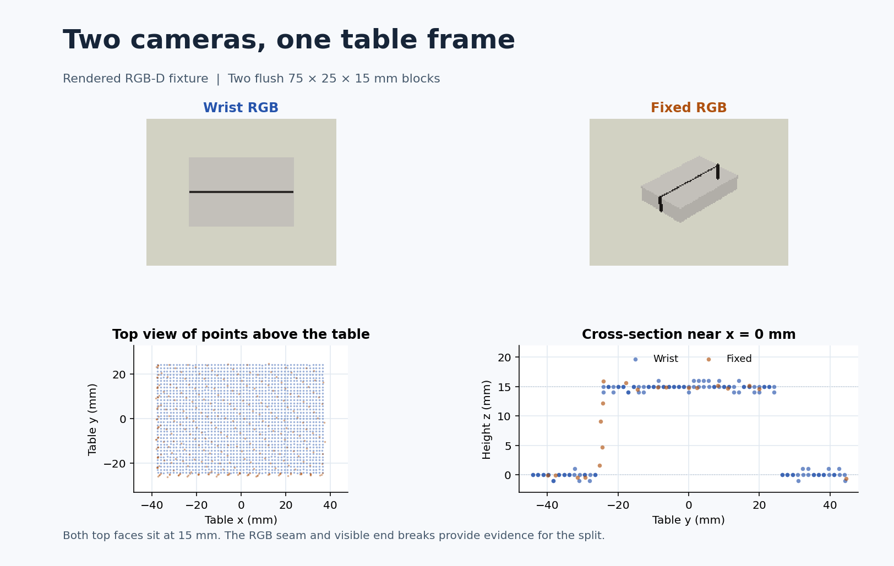
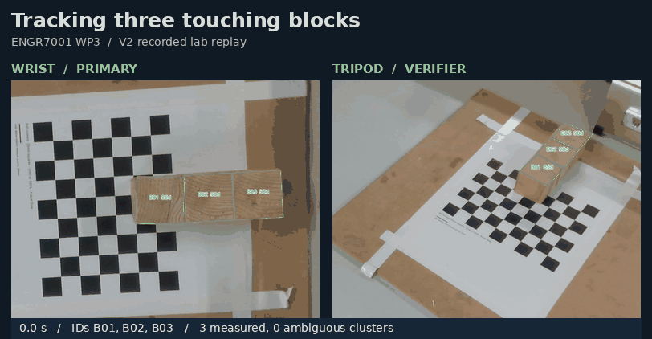
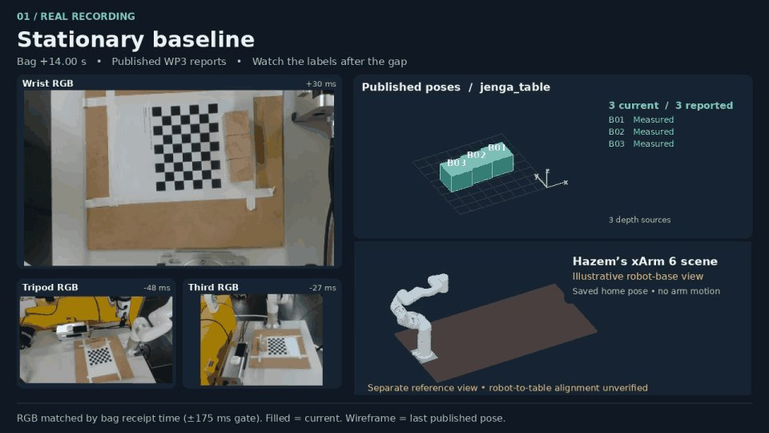

# ENGR7001 robotic perception

WP3 estimates and tracks tabletop block poses for intent-aware shared manipulation in Lancaster University's ENGR7001 Project 7. The ROS 2 perception node publishes observations and RViz displays for the xArm 6 tabletop task.

[Development guide](docs/ITERATIONS.md) | [Recorded lab demo](#recorded-lab-demo) | [Point clouds](#point-clouds) | [Setup and replay](SETUP.md)



The top faces of these synthetic 75 × 25 × 15 mm blocks sit at the same height. Visible RGB seams and block ends give additional evidence for the split.

## WP3 perception at V3.2 (`v3.2-candidate-2`)

WP3 uses a wrist-mounted RealSense and two fixed RealSense cameras to estimate block poses for a Jenga-style manipulation task in ROS 2 Jazzy. The perception node publishes block poses and a scene snapshot. The WP2 bridge updates the MoveIt planning scene from those observations.

| Version | What changed |
|---|---|
| V2 | Added the three-view M1 path, with a third camera to corroborate block boundaries. |
| V3.1 | Added the opt-in V3 region stage and corrected frame handling and publish timestamps. On fake-hardware MoveIt, Hazem's original WP2 bridge passed 10 of 13 checks. The patched bridge passed all 13. |
| V3.2 | Fixed three failures found in the 26 November lab session and added CPU optimisations for the Ryzen 5 5600. The new behaviours can be toggled at runtime for comparisons. |

1. **Duplicate tracks.** A soak run produced 3,203 IDs for three objects. V3.2 merges tracks on the same layer when their spacing is too small for two physical blocks.
2. **Hidden blocks.** V3.1 removed a block from MoveIt after more than three seconds out of view. V3.2 keeps an unseen block until three consecutive frames show its footprint empty or it reaches 60 seconds unseen.
3. **Stale calibration.** V3.2 rereads `/tf_static` once a second, checks each camera's table plane and adds a session-start drift check. A changed fit starts a new calibration epoch, which resets the tracks and prompts the patched bridge to clear the old-calibration obstacles.

The first table-plane thresholds rejected a correctly calibrated tripod camera because oblique depth measurements tilted the estimated plane by 4.7°. The revised check measures height offset at the centre of the workspace. A regression test covers the recorded tripod case.

The CPU changes reproduced the previous solver results on 168 held-out synthetic scenes with an unbounded solver budget. Of 312 blocks, the V2 path published 86, V3 `enumerate` published 175, and V3 `prove` published 190. No published blocks were scored as wrong. The release check recorded 98 passing tests and two expected failures documenting known hazards. The zero-MoveIt audit passed, and the patched bridge passed all 13 fake-hardware MoveIt checks.

Live validation with printed blocks is in progress. Open items include oblique depth bias of about +5 to +9 mm, p95 latency around 230–300 ms, block-like clutter and the choice of threading defaults.

Shadi Hamadamin developed WP3 perception and worked with Hazem on the WP2 twin bridge. Ant Royster led the WP5 planning and fixtures work.

- [V3 notes and evidence](https://github.com/erfrifrung/engr7001-perception/blob/v3.2-candidate-2/versions/v3/README.md)
- [Twin integration setup](https://github.com/erfrifrung/engr7001-perception/blob/docs-v3.2/versions/v3/docs/TWIN_INTEGRATION_SETUP.md) and [V3.2 lab test sheet](https://github.com/erfrifrung/engr7001-perception/blob/docs-v3.2/versions/v3/docs/LAB_SHEET_V32.md)
- [Lab runbook](https://github.com/erfrifrung/engr7001-perception/blob/v3.2-candidate-2/versions/v3/docs/LAB_RUNBOOK.md), [fault matrix](https://github.com/erfrifrung/engr7001-perception/blob/v3.2-candidate-2/versions/v3/docs/FAULT_MATRIX.md) and [WP3 interface specification](https://github.com/erfrifrung/engr7001-perception/blob/v3.2-candidate-2/versions/v3/docs/INTERFACE_SPEC_V1.md)

## Recorded lab demo



V2 replay of a stationary lab recording from 19 November 2026. The wrist view proposes the block poses and the tripod view verifies the layout. Across 60 consecutive replay epochs (4.3 seconds), `whole_partition_mv` resolves all three touching blocks, holds IDs B01–B03 and reports zero ambiguous clusters. Cross-view ID recovery after occlusion remains open.



A separate stationary recording from 12 November 2026 shows the three lab RGB streams (wrist, tripod and third camera), the published `jenga_table` poses for blocks `B01`–`B03`, and a separate illustrative xArm 6 robot-base view from WP2's digital twin at its saved home pose. Robot-to-table alignment remains unverified.

| Snapshot | Main change |
|---|---|
| [Early prototypes](prototypes/) | Wrist-only RGB-D segmentation and the tabletop heightmap comparison with and without RGB seam evidence. |
| [V1](versions/v1/) | Consolidated heightmap, RGB seam cues, side-view verification and a shared live/replay detector with configurable policies. |
| [V2](versions/v2/) | Whole-partition scoring, improved cross-camera depth and skew handling, temporal caching, and explicit tracking and ambiguity states. |
| [V2 three-view candidate](versions/v2-three-view/) | Option to corroborate seams with a third fixed view, plus checkerboard registration tools. |
| [V2 three-view handoff iteration](versions/v2-three-view-handoff/) | Follow-on snapshot from the expanded handoff, with changes to multi-view cut verification, replay, caching, diagnostics and tests. |
| [WP3 twin integration](integration/) | RViz configuration and the discrete WP3 additions for frame fitting and a trial multi-block receiver. |

## Point clouds

Download the [wrist view](media/wp3-synthetic-wrist.ply) and [fixed view](media/wp3-synthetic-fixed.ply) to inspect them together. Both use metres in the same synthetic table frame. The [development guide](docs/ITERATIONS.md) shows how to regenerate them and compares detector output with and without a clear verification view.

## Replay evaluation (V2)

Run the [replay comparison](versions/v2/scripts/compare_bag.py) from the repository root with a SQLite rosbag2 recording. Use `--config` for the block geometry and camera settings of your capture and `--labels` for a CSV of timed ground-truth block positions. See the [setup guide](SETUP.md#run-the-included-synthetic-comparison) for a configuration example.

```bash
bash versions/v2/scripts/compare_bag.sh /path/to/recording --out results/replay \
  --views both --labels /path/to/labels.csv
```

V2 runs the same replay epochs through six policies. `depth_only` and `generic_watershed` are segmentation baselines. `permissive_rgb_seam` and `merged_wrist_rgb` test seam-based splits with different thresholds. `merged_corroborated` checks RGB seams against side-view evidence, and `whole_partition_mv` scores competing block layouts across views. Use `--policies` to select a subset.

The runner prints and saves `decision_table.md`, with per-run frame coverage and p50/p95/p99 processing time. With labels, it reports 15 mm XY matches, flags frames where one prediction region covers multiple labelled blocks, and counts false-confident frames and unmatched detections. XY error is summarised over matched predictions. `comparison_report.json` contains additional metrics, including ambiguity counts and yaw error where yaw labels are available. Per-frame outputs are saved in `predictions/`.

Example from 12 rendered frames of one stationary touching pair, yielding 24 labelled block observations. The timings exclude two warm-up frames and reflect the local run.

| Run | OK / total | 15 mm membership matches | Merge frames | False-confident frames | XY error p50/p95 (mm) | Runtime p50/p95/p99 (ms) |
|---|---:|---:|---:|---:|---:|---:|
| `both__depth_only` | 12/12 | 0/24 | 0 | 0% | — | 41.06 / 51.79 / 55.98 |
| `both__merged_corroborated` | 12/12 | 24/24 | 0 | 0% | 0.22 / 0.29 | 60.24 / 88.14 / 91.87 |
| `both__whole_partition_mv` | 12/12 | 24/24 | 0 | 0% | 0.22 / 0.29 | 60.99 / 102.65 / 106.62 |

The [synthetic suite](versions/v2/scripts/run_printed_jenga_suite.py) generates inputs and a separate summary table without a recording. The [stereo depth benchmark](versions/v2/scripts/bench_stereo_depth.py) reports OpenCV StereoSGBM coverage and runtime. Pass `--native-depth` with a 16-bit D435 frame from the same capture aligned to the left IR grid to report agreement over valid pixels in both depth maps. Use the camera's measured baseline, focal length and depth scale.

## Perception safety check

Run `python3 versions/v2/scripts/verify_zero_moveit.py` from the repository root. This static check scans the perception snapshot for MoveIt and robot-control imports and for planning-scene service and trajectory-action references. Its scope is the display-only snapshot. The optional planning-scene receiver is described in the [integration setup](SETUP.md#wp3-and-the-digital-twin).

## Development evidence

- On one recorded row of three touching wooden blocks, the RGB seam detector returned the correct count in **135/141 frames versus 0/141 with depth alone**, flagging the remaining six as ambiguous.
- In a stationary **720p** lab trial while recording all three streams, Fast DDS shared memory increased live **two-view** scene updates from **2.42 to 13.16 Hz** (rounded to 2.4 and 13.2 Hz on the CV).
- These development runs used recorded wooden props and a stationary rig. Independent physical accuracy on 3D-printed blocks, comparative accuracy of the third view, and acceptance in the full twin or planning workflow remain open.

Start with the [setup and replay guide](SETUP.md). See the [source and sharing inventory](INVENTORY.md) for attribution and the [local verification](VERIFICATION.md) for build and test results.
