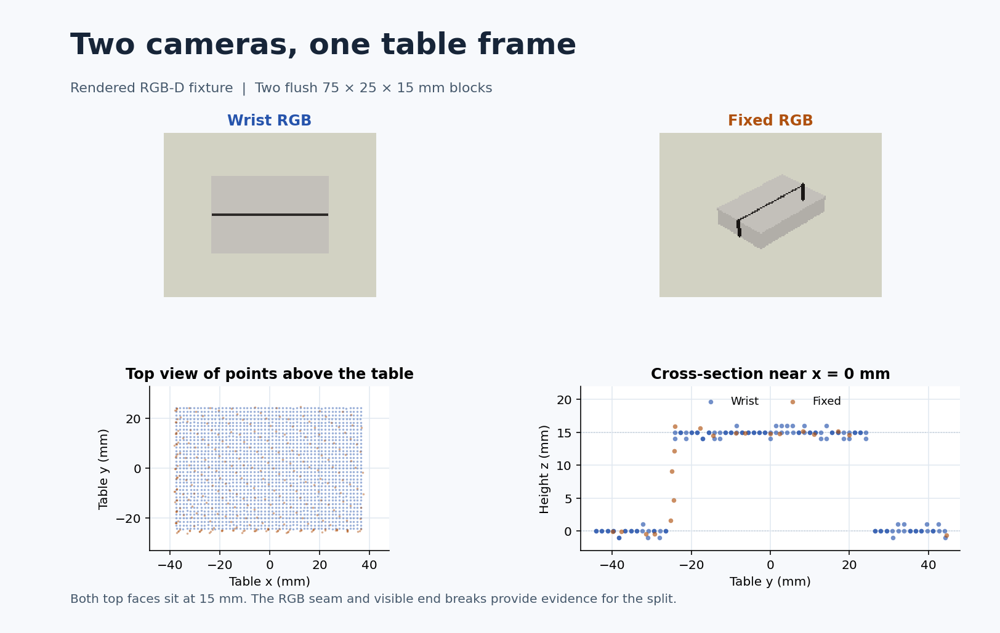
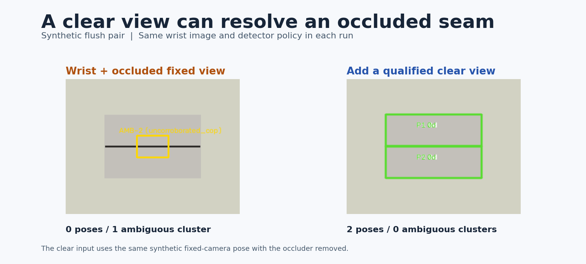

# WP3 perception iterations

WP3 estimates and tracks tabletop blocks for shared manipulation with an xArm 6. A wrist RealSense sees the top faces. Fixed RealSense cameras can see the block ends that an overhead view misses. Qualifying camera observations in a shared table frame lets WP3 cross-check a boundary before publishing poses. The WP2 bridge updates the MoveIt scene. WP5 decides whether an observation is eligible as a motion target.

| Iteration | Improvement | Trade-off or remaining check |
|---|---|---|
| [Wrist-only prototype](../prototypes/WP3-One-Camera-2026-11-18/) | Established an RGB-D baseline with simpler capture and calibration. | A single overhead view misses block ends. Coplanar neighbours can look like one object. |
| [Heightmap prototypes](../prototypes/WP3-Heightmap-2026-11-18/) | Put depth into a table-aligned grid and tested RGB seams. On one stationary three-block recording the RGB route returned the correct count in 135 of 141 frames, versus 0 of 141 for depth alone. The remaining six were ambiguous. | This is a block-count result on one recording. Pose accuracy and robustness to texture still needed separate testing. |
| [V1](../versions/v1/) | Unified heightmaps, RGB seam proposals and side-view verification in a detector that could run live or replay data. | A side view can lose the end-face evidence. ROS loopback retests sometimes missed initial scenes. |
| [V2](../versions/v2/) | Scores whole partitions, qualifies camera inputs by timing and depth, and records ambiguity and track state. Temporal caching and a shared-memory ROS profile reduced repeated work and transport overhead in their respective tests. | Partition search takes compute. In the README's 12-frame example, whole-partition and merged-corroborated both matched 24 of 24 opportunities, with p95 runtimes of 102.65 ms and 88.14 ms respectively. |
| [V2 three-view candidate](../versions/v2-three-view/) | Added an optional fixed view to corroborate cuts, plus checkerboard registration tools. The extra evidence can support or challenge a split. | Benefits depend on timing, calibration and which faces the added view can see. Camera-dropout loopback behaviour was intermittent. |
| [V2 three-view handoff](../versions/v2-three-view-handoff/) | Extended the three-view path through replay, caching and diagnostics. In the controlled occlusion example below, a clear extra input turns one ambiguous cluster into two published poses. | The fixture uses the same fixed-camera geometry with and without an occluder. It gives a controlled comparison of evidence, while a physical test needs independently positioned cameras and a common labelled sequence. |
| [V3.1 M1 candidate 2](https://github.com/erfrifrung/engr7001-perception/tree/v3.1-m1-candidate-2) | Added the opt-in V3 region path and corrected frame handling and publish timestamps. The WP2 patch passed 13 of 13 tests against fake-hardware MoveIt, up from 10 of 13 for the original bridge. | Extra coverage adds compute. The integration checks used fake hardware. |
| [V3.1 M1 candidate 3](https://github.com/erfrifrung/engr7001-perception/tree/v3.1-m1-candidate-3) | Added view qualification before decoding and a direct twin test. The recorded fault checks 7 and 9 passed. | A soak produced 3,203 track IDs for three objects. A block hidden for over three seconds could be removed without an empty-footprint observation. |
| [V3.2 candidate 1](https://github.com/erfrifrung/engr7001-perception/tree/v3.2-candidate-1) | Merges duplicate same-layer tracks, holds hidden obstacles until three empty-footprint observations or a 60-second timeout, and checks camera calibration during operation. | An unresolved obstacle can still expire. Bridge reset and parked-wrist refresh had gaps in the first implementation. |
| [V3.2 candidate 2](https://github.com/erfrifrung/engr7001-perception/tree/v3.2-candidate-2) | Adds CPU fast paths, event-driven wakeup and calibration-epoch reset handling through the bridge. The CPU changes reproduced the earlier solver counts on the held-out synthetic dataset. | Oblique depth bias, 230–300 ms p95 latency, block-like clutter and threading defaults remain open. Live acceptance with the printed blocks is in progress. |

## What the evidence shows

The top faces sit at the same height. RGB gives a candidate seam and the fixed view can corroborate it where the end is visible. On the nine-scene V2 synthetic suite, `permissive_rgb_seam` and `whole_partition_mv` each had eight correct outcomes. Whole-partition scoring had zero false-confident negative or heading outcomes and two abstentions. The permissive policy had one false-confident outcome and no abstentions.

The handoff fixture uses the same wrist frame and `merged_corroborated` policy throughout. With a blocked fixed view it returns zero poses and one ambiguous cluster. With the additional clear input it returns two poses and zero ambiguous clusters. The [recorded lab demo](../README.md#recorded-lab-demo) shows a separate check of V2 tracking on real wooden blocks.

| V3 review solver path | Published blocks out of 312 | Incorrect published blocks |
|---|---:|---:|
| V2 path | 86 | 0 |
| V3 enumerate | 175 | 0 |
| V3 prove | 190 | 0 |

The V3 review used 168 held-out synthetic scenes and an unbounded solver budget. These counts measure coverage under the benchmark rules. Live p95 latency comes from separate measurements.

## Reproduce the examples

From the repository root, with NumPy, SciPy, OpenCV and Matplotlib available, run `python3 scripts/make_portfolio_visuals.py`. Open the [wrist PLY](../media/wp3-synthetic-wrist.ply) and [fixed-view PLY](../media/wp3-synthetic-fixed.ply) together in a point-cloud viewer. Both use metres and the same synthetic `jenga_table` frame. The exports use a workspace crop and sample every third depth pixel in each direction.

Use the [V2 synthetic suite](../SETUP.md#run-the-included-synthetic-comparison) to run all nine scenarios and the [verification record](../VERIFICATION.md) to check bench and ROS coverage. From `versions/v2-three-view-handoff`, `python3 -m pytest -q tests/test_third_view.py` runs the third-view regressions. The [V3 lab test sheet](https://github.com/erfrifrung/engr7001-perception/blob/docs-v3.2/versions/v3/docs/LAB_SHEET_V32.md) covers calibration, occlusion, duplicate tracks and scene reset.
